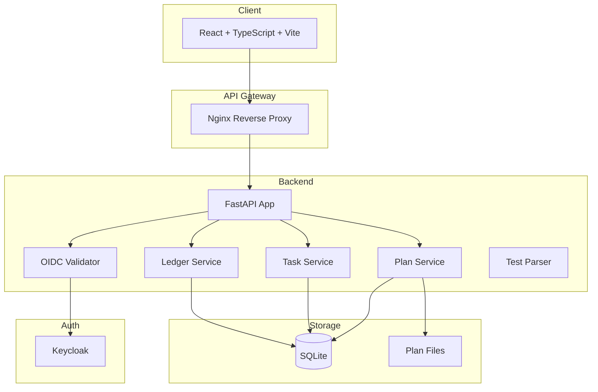

# Beacon Station — Ryan Vo | AI & Machine Learning

> Work in progress. This checkpoint may be incomplete or fail tests. See PLAN.md and STATUS.md before use.


> Agentic skills framework & software development methodology for token-efficient LLM agent workflows.

**Maintainer:** Ryan Vo <ryandtvo@gmail.com>

## Overview

Beacon Station is a full-stack application for managing AI agent workflows using the Superpowers methodology. It provides a structured approach to plan-driven development with token-efficient execution, supporting both subagent-driven and agent-team orchestration patterns.

### Problem

Modern LLM agents consume excessive tokens when executing complex multi-step plans. Monolithic plan files require repeated full-context reads, and subagent orchestration lacks standardized tooling for task dispatch, ledger tracking, and test result parsing.

### Solution

Beacon Station implements:
- **Split-plan storage**: Plans stored as overview + per-task markdown files for token-efficient access
- **Test result parsing**: Extracts pass/fail/duration from `node --test`, `pytest`, `jest`, `vitest`, `cargo test`, `go test`
- **Execution ledger**: Immutable record of task execution with commits, test results, and token usage
- **Multi-mode execution**: Subagent, Agent Team, and Single Session modes
- **OIDC authentication**: Keycloak with PKCE, HttpOnly cookies, role-based access control

### Intended Users

- AI engineers building agent-driven workflows
- Teams adopting Superpowers methodology
- Researchers evaluating token efficiency in LLM agent orchestration

## AI/ML Evaluation

This application supports AI/ML workflows through:

1. **Token estimation**: Character-based token counting for plan/task sizing
2. **Execution tracking**: Ledger records actual token usage per task
3. **Test result parsing**: Standardized extraction from common test runners
4. **Subagent dispatch simulation**: Focused prompts per task reduce context pollution

**Reproducible evaluation command:**
```bash
# After starting the stack
curl -X POST http://localhost:8000/api/v1/plans \
  -H "Content-Type: application/json" \
  -d '{"name": "Eval Plan", "tasks": [{"title": "Task 1", "description": "Test"}]}'
```

**Baseline:** Monolithic 48k-char plan → ~45-60k tokens re-read across 9 tasks
**Target:** Split plan + subagent dispatch → ~22-33k tokens (1.5-2x improvement)

**Failure cases:**
- Test runners without recognizable summary lines fall back to exit code only
- Very large task descriptions (>10k chars) still consume significant tokens
- Agent Teams mode requires `CLAUDE_CODE_EXPERIMENTAL_AGENT_TEAMS=1` (not simulated in API)

## Quick Start

### Prerequisites
- Docker 24+ and Docker Compose 2+
- Node 24+ (for frontend development)
- Python 3.12+ (for backend development)

### With Docker Compose (Recommended)

```bash
# Clone and navigate
git clone https://github.com/A220man/beacon-station-ryan-vo.git
cd beacon-station-ryan-vo

# Copy environment template
cp .env.example .env

# Start all services
docker compose up -d

# Access services
# Frontend: http://localhost:5173
# Backend API: http://localhost:8000/api/v1
# Keycloak Admin: http://localhost:8080 (admin/admin)
```

### Local Development

**Backend:**
```bash
cd backend
python -m venv .venv
source .venv/bin/activate
pip install -r requirements.txt
cp ../.env.example .env
python -m uvicorn app.main:app --reload --host 127.0.0.1 --port 8000
```

**Frontend:**
```bash
cd frontend
npm install
npm run dev
```

### Running Tests

**Backend:**
```bash
cd backend
.venv/bin/python -m pytest tests/ -v
```

**Frontend:**
```bash
cd frontend
npm test
npm run build
```

## Architecture



## API Reference

### Health
- `GET /api/v1/health` — System health check
- `GET /api/v1/auth/test` — Authentication test (requires auth)

### Plans
- `POST /api/v1/plans` — Create plan
- `GET /api/v1/plans` — List plans (paginated, filterable)
- `GET /api/v1/plans/{id}` — Get plan with tasks and ledger
- `PATCH /api/v1/plans/{id}` — Update plan
- `DELETE /api/v1/plans/{id}` — Delete plan

### Tasks
- `POST /api/v1/plans/{id}/tasks` — Add task
- `GET /api/v1/plans/{id}/tasks` — List tasks
- `GET /api/v1/plans/{id}/tasks/{taskId}` — Get task
- `PATCH /api/v1/plans/{id}/tasks/{taskId}` — Update task

### Ledger
- `POST /api/v1/plans/{id}/ledger` — Add ledger entry
- `GET /api/v1/plans/{id}/ledger` — Get ledger entries

## Security Limitations

- **Demo mode only**: Local development uses `DEMO_MODE=true` which bypasses OIDC. Production deployments **must** set `DEMO_MODE=false` and configure Keycloak.
- **SQLite**: Default persistence uses SQLite. Production should use PostgreSQL with connection pooling.
- **No TLS**: Docker Compose binds to 127.0.0.1. Production requires reverse proxy with TLS termination (nginx, Traefik, Caddy).
- **Secrets**: All credentials via environment variables. Never commit `.env` or real keys.
- **Token storage**: Frontend uses in-memory tokens only. No localStorage persistence.

## Provider Configuration

| Provider | LLM_PROVIDER | LLM_MODEL | LLM_BASE_URL | Notes |
|----------|-------------|-----------|--------------|-------|
| OpenAI | `openai` | `gpt-4o` | — | Requires `LLM_API_KEY` |
| Anthropic | `anthropic` | `claude-3-5-sonnet` | — | Requires `LLM_API_KEY` |
| Gemini | `gemini` | `gemini-1.5-pro` | — | Requires `LLM_API_KEY` |
| Ollama | `ollama` | `llama3.1` | `http://localhost:11434` | Local, no API key |
| OpenRouter | `openai` | `openrouter/auto` | `https://openrouter.ai/api/v1` | Requires `LLM_API_KEY` |
| LiteLLM | `openai` | `gpt-4o` | `http://litellm:4000` | Proxy, requires `LLM_API_KEY` |

## SSO/SAML Setup

Keycloak supports SAML 2.0 identity brokering:

1. **Add Identity Provider** in Keycloak Admin Console → Identity Providers → SAML v2.0
2. **Configure** SAML entity ID, SSO URL, and certificate from your IdP (Okta, Azure AD, Auth0, etc.)
3. **Map attributes** (email, firstName, lastName) to Keycloak user attributes
4. **Assign roles** via First Broker Login flow or group mappers
5. **Test** with `docker compose logs keycloak`

No native SAML implementation in application code — relies on Keycloak's battle-tested broker.

## Backup & Restore

```bash
# Backup
docker compose exec backend sqlite3 /app/data/beacon.db .dump > backup.sql
docker compose exec keycloak /opt/keycloak/bin/kc.sh export --dir /opt/keycloak/data/export --realm beacon-station

# Restore
docker compose exec -i backend sqlite3 /app/data/beacon.db < backup.sql
docker compose exec keycloak /opt/keycloak/bin/kc.sh import --dir /opt/keycloak/data/import
```

## Deployment

### TLS Reverse Proxy (Production)

```nginx
server {
    listen 443 ssl http2;
    server_name beacon.example.com;

    ssl_certificate /etc/ssl/certs/beacon.crt;
    ssl_certificate_key /etc/ssl/private/beacon.key;

    location / {
        proxy_pass http://frontend:5173;
        proxy_set_header Host $host;
        proxy_set_header X-Real-IP $remote_addr;
    }

    location /api/ {
        proxy_pass http://backend:8000;
        proxy_set_header Host $host;
        proxy_set_header X-Real-IP $remote_addr;
    }
}
```

### Environment

Set `ENVIRONMENT=production`, `DEMO_MODE=false`, and provide real OIDC credentials. Use PostgreSQL:

```
DATABASE_URL=postgresql+asyncpg://user:pass@db:5432/beacon
```

## Project Structure

```
beacon-station-ryan-vo/
├── backend/
│   ├── app/
│   │   ├── api/          # FastAPI routes
│   │   ├── core/         # Config, DB, Auth
│   │   ├── models/       # SQLAlchemy models
│   │   └── services/     # Business logic
│   ├── tests/            # Pytest tests
│   ├── requirements.txt
│   └── Dockerfile
├── frontend/
│   ├── src/
│   │   ├── components/   # React components
│   │   ├── pages/        # Page components
│   │   ├── hooks/        # Custom hooks
│   │   ├── api/          # API client
│   │   ├── types/        # TypeScript types
│   │   └── styles/       # CSS
│   ├── package.json
│   ├── Dockerfile
│   └── nginx.conf
├── keycloak/
│   └── realm-export.json
├── compose.yaml
├── .env.example
├── Dockerfile
├── README.md
├── LICENSE
├── CHANGELOG.md
├── PLAN.md
├── STATUS.md
├── feature-plan.json
├── portfolio.json
└── pyproject.toml
```

## Changelog

See [CHANGELOG.md](CHANGELOG.md)

## License

MIT © Ryan Vo <ryandtvo@gmail.com>